# AFD y Tokens — Mini-calc

Documentación técnica del analizador léxico y sintáctico del lenguaje **Mini-calc**.

---

## Tabla de contenidos

1. [Visión general del proyecto](#1-visión-general-del-proyecto)
2. [Alfabeto y tokens del lenguaje](#2-alfabeto-y-tokens-del-lenguaje)
3. [Definición formal del AFD](#3-definición-formal-del-afd)
4. [Tabla de transiciones δ](#4-tabla-de-transiciones-δ)
5. [Diagrama de estados (Mermaid)](#5-diagrama-de-estados-mermaid)
6. [Descripción de cada estado](#6-descripción-de-cada-estado)
7. [Explicación detallada de cada transición](#7-explicación-detallada-de-cada-transición)
8. [Integración con el parser](#8-integración-con-el-parser)
9. [Gramática libre de contexto](#9-gramática-libre-de-contexto)
10. [Ejemplos de ejecución](#10-ejemplos-de-ejecución)

---

## 1. Visión general del proyecto

**Mini-calc** es un intérprete mínimo que procesa un lenguaje de calculadora con dos tipos de sentencias:

| Sentencia   | Sintaxis             | Efecto                                            |
|-------------|----------------------|---------------------------------------------------|
| Asignación  | `ID = expresion ;`   | Asigna el valor de la expresión a una variable    |
| Impresión   | `print expresion ;`  | Evalúa e imprime la expresión                     |

El procesamiento se divide en dos fases secuenciales:

```
Código fuente (.calc)
        │
        ▼
  ┌───────────┐      tokens[]
  │  Lexer    │ ──────────────────► ┌─────────────┐
  │ (lexer.py)│                     │   Parser    │ ──► Árbol de derivación
  └───────────┘                     │ (parser.py) │
                                    └─────────────┘
```

Los archivos del proyecto y sus responsabilidades:

| Archivo        | Responsabilidad                                               |
|----------------|---------------------------------------------------------------|
| `lexer.py`     | Análisis léxico: convierte texto en tokens                    |
| `parser.py`    | Análisis sintáctico: valida la gramática y construye el árbol |
| `errores.py`   | Define `ErrorLexico` y `ErrorSintactico`                      |
| `arbol.py`     | Nodo de árbol de derivación con visualización en consola      |
| `main.py`      | Punto de entrada: orquesta léxico + sintáctico                |
| `pruebas.py`   | Suite de 11 pruebas funcionales                               |
| `ejemplo.calc` | Programa de demostración con asignaciones y `print`           |
| `prueba2.calc` | Segundo programa de demostración                             |

---

## 2. Alfabeto y tokens del lenguaje

### 2.1 Alfabeto de entrada Σ

El lexer acepta únicamente los siguientes caracteres:

```
Σ = { a–z, 0–9, =, +, -, *, /, (, ), ;, ' ', \t, \r, \n }
```

Cualquier carácter fuera de este conjunto provoca un **error léxico**.

### 2.2 Tokens producidos

| Token          | Lexema ejemplo   | Descripción                                               |
|----------------|------------------|-----------------------------------------------------------|
| `KW_PRINT`     | `print`          | Palabra reservada; sólo si no le sigue `[a-z0-9]`        |
| `ID`           | `x`, `a`, `z`    | Variable de **una sola** letra minúscula                  |
| `NUM`          | `0`, `42`, `100` | Secuencia de uno o más dígitos                            |
| `OP_ASSIGN`    | `=`              | Operador de asignación                                    |
| `OP_ADD`       | `+`              | Operador de suma                                          |
| `OP_SUB`       | `-`              | Operador de resta                                         |
| `OP_MUL`       | `*`              | Operador de multiplicación                                |
| `OP_DIV`       | `/`              | Operador de división                                      |
| `PUNCT_LPAREN` | `(`              | Paréntesis izquierdo                                      |
| `PUNCT_RPAREN` | `)`              | Paréntesis derecho                                        |
| `PUNCT_SEMI`   | `;`              | Punto y coma (terminador de sentencia)                    |
| `EOF`          | _(vacío)_        | Fin de archivo; marca el cierre de `programa` en el parser|

### 2.3 Caracteres ignorados (no producen token)

| Carácter | Acción en el lexer                                     |
|----------|--------------------------------------------------------|
| `' '`    | Avanza `posicion` y `columna`                          |
| `\t`     | Avanza `posicion` y `columna`                          |
| `\r`     | Avanza `posicion` y `columna`                          |
| `\n`     | Avanza `posicion`, incrementa `linea`, fija `columna = 1` |

> **Nota de implementación:** la tupla de cada token es `(tipo, valor, linea, columna)`.
> La columna registrada para `NUM` corresponde al **primer dígito** de la secuencia.

---

## 3. Definición formal del AFD

### 3.1 La 5-tupla

$$M = (Q,\; \Sigma,\; \delta,\; q_0,\; F)$$

#### Conjunto de estados Q

$$Q = \{q_0,\; q_1,\; q_2,\; q_3,\; q_4,\; q_5,\; q_6,\; q_7,\; q_8,\; q_9,\; q_{err}\}$$

| Estado    | Nombre informal        | Rol resumido                                                             |
|-----------|------------------------|--------------------------------------------------------------------------|
| $q_0$     | Inicio / Despacho      | Lee el siguiente carácter y elige la transición correspondiente          |
| $q_1$     | Candidato `print`      | Verifica si el prefijo `"print"` es la palabra reservada o solo una letra|
| $q_2$     | Aceptación `KW_PRINT`  | La cadena `"print"` fue confirmada como token reservado                  |
| $q_3$     | Aceptación `ID`        | Se leyó exactamente una letra minúscula como identificador               |
| $q_4$     | Acumulando `NUM`       | Se están leyendo dígitos consecutivos (auto-bucle)                       |
| $q_5$     | Aceptación `NUM`       | El flujo de dígitos se interrumpió; el número está completo              |
| $q_6$     | Aceptación `OP_ASSIGN` | Se leyó `=`                                                              |
| $q_7$     | Aceptación operador    | Se leyó `+`, `-`, `*` o `/`                                              |
| $q_8$     | Aceptación puntuación  | Se leyó `(`, `)` o `;`                                                   |
| $q_9$     | Blanco / Salto         | Se actualizan contadores de línea/columna y se regresa a $q_0$           |
| $q_{err}$ | Error léxico           | Carácter fuera de Σ; lanza `ErrorLexico` y detiene el análisis           |

#### Conjunto de estados de aceptación F

$$F = \{q_2,\; q_3,\; q_5,\; q_6,\; q_7,\; q_8\}$$

> $q_9$ **no** es de aceptación: sólo actualiza contadores y regresa a $q_0$.
> $q_{err}$ es el estado trampa; interrumpe el análisis con excepción.

#### Estado inicial

$$q_0$$

#### Clasificación del alfabeto Σ

| Grupo             | Símbolos                        |
|-------------------|---------------------------------|
| Letras            | `a` – `z`                       |
| Dígitos           | `0` – `9`                       |
| Operadores        | `=`, `+`, `-`, `*`, `/`         |
| Puntuación        | `(`, `)`, `;`                   |
| Blancos           | `' '`, `\t`, `\r`, `\n`         |
| Otros (∉ Σ)       | Cualquier otro carácter Unicode |

---

## 4. Tabla de transiciones δ

La función $\delta : Q \times \Sigma \rightarrow Q$ se muestra a continuación.
Una celda con `—` indica que esa combinación no ocurre desde ese estado.

> **Convención:** cuando el AFD alcanza un estado de aceptación, emite el token correspondiente y **regresa a $q_0$**. Para tokens de un solo carácter ese carácter ya fue consumido; para `NUM`, el carácter que rompió el bucle **no** se consume (el índice no avanza).

### Desde $q_0$ (estado inicial)

| Entrada                                            | Estado siguiente | Token emitido         |
|----------------------------------------------------|------------------|-----------------------|
| `"print"` seguido de `EOF` o no-alfanumérico       | $q_2$            | `KW_PRINT`            |
| `"print"` seguido de letra o dígito               | $q_3$            | `ID` (solo `"p"`)     |
| Letra `[a-z]` que no inicia `"print"` como reservada | $q_3$         | `ID`                  |
| Dígito `[0-9]`                                     | $q_4$            | _(pendiente)_         |
| `=`                                                | $q_6$            | `OP_ASSIGN`           |
| `+`, `-`, `*`, `/`                                 | $q_7$            | `OP_ADD/SUB/MUL/DIV`  |
| `(`, `)`, `;`                                      | $q_8$            | `PUNCT_L/RPAREN/SEMI` |
| `' '`, `\t`, `\r`, `\n`                            | $q_9$            | _(ninguno)_           |
| Cualquier otro carácter (∉ Σ)                      | $q_{err}$        | _(excepción)_         |

### Desde $q_4$ (acumulando NUM)

| Entrada              | Estado siguiente | Acción                               |
|----------------------|------------------|--------------------------------------|
| Dígito `[0-9]`       | $q_4$            | Acumula dígito en `numero`, avanza   |
| Cualquier no-dígito  | $q_5$            | Sale del bucle **sin** consumir      |
| Fin de archivo       | $q_5$            | Sale del bucle                       |

### Desde $q_2$, $q_3$, $q_5$, $q_6$, $q_7$, $q_8$ (aceptación)

Todos regresan automáticamente a $q_0$ tras emitir su token. No tienen transiciones salientes propias.

### Desde $q_9$ (blanco)

Regresa a $q_0$ inmediatamente, sin emitir token.

### Desde $q_{err}$ (trampa)

Lanza `ErrorLexico` y termina la ejecución. No hay retorno.

---

## 5. Diagrama de estados (Mermaid)

```mermaid
stateDiagram-v2
    direction LR

    [*] --> q0 : inicio

    %% ── Blancos y saltos de línea ──────────────────────────────
    q0 --> q9  : BLANCO / TAB / CR / LF
    q9 --> q0  : actualiza contadores · no emite token

    %% ── Palabra reservada print ─────────────────────────────────
    q0 --> q1  : prefijo candidato "print"
    q1 --> q2  : completo · siguiente no es [a-z0-9] ni EOF
    q1 --> q3  : completo · siguiente es [a-z0-9]
    q1 --> q3  : prefijo no coincide

    q2 --> [*] : ACEPTA · emite KW_PRINT

    %% ── Identificador ────────────────────────────────────────────
    q0 --> q3  : letra [a-z] (distinta de inicio de print reservada)
    q3 --> [*] : ACEPTA · emite ID (1 carácter)

    %% ── Número entero ────────────────────────────────────────────
    q0 --> q4  : dígito [0-9]
    q4 --> q4  : dígito [0-9]  · acumula
    q4 --> q5  : no-dígito  · no consume el carácter
    q5 --> [*] : ACEPTA · emite NUM

    %% ── Operador de asignación ───────────────────────────────────
    q0 --> q6  : '='
    q6 --> [*] : ACEPTA · emite OP_ASSIGN

    %% ── Operadores aritméticos ───────────────────────────────────
    q0 --> q7  : '+' | '-' | '*' | '/'
    q7 --> [*] : ACEPTA · emite OP_ADD | OP_SUB | OP_MUL | OP_DIV

    %% ── Puntuación ───────────────────────────────────────────────
    q0 --> q8  : '(' | ')' | ';'
    q8 --> [*] : ACEPTA · emite PUNCT_LPAREN | PUNCT_RPAREN | PUNCT_SEMI

    %% ── Error léxico ─────────────────────────────────────────────
    q0 --> qerr : carácter fuera de Σ
    qerr --> [*] : ERROR · lanza ErrorLexico (linea, columna)
```



> **Renderizado:** GitHub, GitLab y VS Code (con la extensión *Markdown Preview Mermaid Support*) muestran el diagrama de forma gráfica al abrir este archivo.

---

## 6. Descripción de cada estado

| Estado    | Tipo            | Token que emite                               | Descripción funcional                                                                                                         |
|-----------|-----------------|-----------------------------------------------|-------------------------------------------------------------------------------------------------------------------------------|
| $q_0$     | Inicial         | —                                             | **Despacho central.** Lee `self.codigo[self.posicion]` y elige la transición. Ningún token se emite aquí.                     |
| $q_1$     | Intermedio      | —                                             | **Verificación de `print`.** Detectada la `p`, comprueba que los 4 caracteres siguientes formen `rint` y que el carácter posterior no sea alfanumérico. |
| $q_2$     | **Aceptación**  | `KW_PRINT`                                    | Cadena `"print"` confirmada como palabra reservada. Avanza 5 posiciones. Emite `("KW_PRINT", "print", linea, columna)`.       |
| $q_3$     | **Aceptación**  | `ID`                                          | Una letra minúscula como identificador. Emite `("ID", caracter, linea, columna)`. Solo un carácter.                           |
| $q_4$     | Intermedio      | —                                             | **Bucle de dígitos.** Acumula cada dígito en `numero` y avanza. Permanece en $q_4$ mientras sigan llegando dígitos.           |
| $q_5$     | **Aceptación**  | `NUM`                                         | El primer carácter no-dígito (o EOF) interrumpe $q_4$. Emite `("NUM", numero, linea, columna_inicio)` con la columna del primer dígito. |
| $q_6$     | **Aceptación**  | `OP_ASSIGN`                                   | Leído `=`. Emite `("OP_ASSIGN", "=", linea, columna)` y avanza una posición.                                                  |
| $q_7$     | **Aceptación**  | `OP_ADD` / `OP_SUB` / `OP_MUL` / `OP_DIV`    | Leído uno de `+`, `-`, `*`, `/`. El tipo se obtiene del diccionario `simbolos` en `lexer.py`.                                 |
| $q_8$     | **Aceptación**  | `PUNCT_LPAREN` / `PUNCT_RPAREN` / `PUNCT_SEMI`| Leído uno de `(`, `)`, `;`. Mismo mecanismo que $q_7$.                                                                        |
| $q_9$     | Transitorio     | _(ninguno)_                                   | **Gestión de blancos.** `' '`, `\t`, `\r` avanzan columna. `\n` incrementa línea y reinicia columna a 1. Regresa a $q_0$.    |
| $q_{err}$ | **Error trampa**| _(excepción)_                                 | Carácter fuera de Σ. Lanza `ErrorLexico(mensaje, linea, columna)`. Detiene el análisis completamente.                         |

---

## 7. Explicación detallada de cada transición

### 7.1 Blancos — $q_0 \xrightarrow{\text{blanco}} q_9 \rightarrow q_0$

```python
# En lexer.py → método analizar()
if caracter in " \t\r":
    self.avanzar()      # posicion += 1 · columna += 1
    continue

if caracter == "\n":
    self.posicion += 1
    self.linea += 1
    self.columna = 1
    continue
```

Espacios, tabulaciones y retornos de carro sólo avanzan el cursor de columna. El salto de línea (`\n`) reinicia la columna a 1 y suma 1 a la línea. El `continue` vuelve al inicio del `while`, equivalente a regresar a $q_0$ sin emitir token.

**Importancia:** permite que los mensajes de error reporten posiciones exactas independientemente del formato del archivo `.calc` (espaciado libre, indentación, archivos con `\r\n` de Windows).

---

### 7.2 Palabra reservada — $q_0 \xrightarrow{\text{"print"}} q_1 \xrightarrow{?} q_2$ o $q_3$

```python
if self.codigo.startswith("print", self.posicion):
    fin = self.posicion + 5
    if fin == len(self.codigo) or not (
        self.es_letra(self.codigo[fin])
        or self.es_digito(self.codigo[fin])
    ):
        self.agregar_token("KW_PRINT", "print")
        for _ in range(5):
            self.avanzar()     # consume 'p','r','i','n','t'
        continue
# Si la condición falla, continúa hacia el bloque de ID
```

La transición opera en dos sub-pasos:

1. **Coincidencia de prefijo.** `str.startswith("print", pos)` examina los 5 caracteres desde la posición actual en O(1). No consume ningún carácter todavía.

2. **Verificación de límite de palabra.** Se calcula `fin = pos + 5`. Si `fin` supera el tamaño del archivo (EOF), o si el carácter en `fin` no es letra ni dígito, entonces `"print"` está aislado como palabra reservada → $q_2$, se emite `KW_PRINT` y se avanza 5 posiciones.

   Si el carácter en `fin` **sí** es alfanumérico (p. ej. `printa`, `print2`), la condición falla, el `if` no se ejecuta, y el flujo llega al bloque de identificadores, emitiendo `ID` = `"p"` → $q_3$.

**Esta regla implementa prioridad de la palabra reservada sobre el identificador.**

| Entrada       | Resultado                                                     |
|---------------|---------------------------------------------------------------|
| `print x`     | `KW_PRINT` (el espacio después no es alfanumérico)            |
| `print;`      | `KW_PRINT` (`;` no es alfanumérico)                           |
| `print` (EOF) | `KW_PRINT` (`fin == len(codigo)`)                             |
| `printa`      | `ID("p")`, `ID("r")`, `ID("i")`, `ID("n")`, `ID("t")`, `ID("a")` |
| `print2`      | `ID("p")`, `ID("r")`, `ID("i")`, `ID("n")`, `ID("t")`, `NUM("2")` |

---

### 7.3 Identificadores — $q_0 \xrightarrow{[a\text{-}z]} q_3$

```python
if self.es_letra(caracter):
    self.agregar_token("ID", caracter)
    self.avanzar()
    continue
```

Este bloque sólo se alcanza **después** de que el bloque `"print"` no haya consumido nada. El lexer emite un `ID` de **exactamente un carácter** (`"a"` ≤ `caracter` ≤ `"z"`) y avanza una posición.

**Por qué solo una letra:** la gramática de Mini-calc no soporta identificadores multi-carácter. La entrada `xy` produce `ID("x")` seguido de `ID("y")`. La sentencia `xy = 5;` sería un error sintáctico porque tras el primer `ID("x")` el parser espera `OP_ASSIGN` y encuentra `ID("y")`.

---

### 7.4 Números enteros — $q_0 \xrightarrow{[0\text{-}9]} q_4 \xrightarrow{[0\text{-}9]^*} q_4 \xrightarrow{\overline{[0\text{-}9]}} q_5$

```python
if self.es_digito(caracter):
    inicio = self.columna          # columna del primer dígito
    numero = ""

    while (
        self.posicion < len(self.codigo)
        and self.es_digito(self.codigo[self.posicion])
    ):
        numero += self.codigo[self.posicion]
        self.avanzar()

    self.tokens.append(("NUM", numero, self.linea, inicio))
    continue
```

$q_4$ es el único estado del AFD con **auto-bucle**: mientras el carácter corriente sea dígito, se acumula en `numero` y se avanza. En cuanto aparece un carácter no-dígito, el `while` termina **sin consumirlo** (el índice no se mueve). La columna de inicio se captura antes del bucle para que el token reporte la posición del primer dígito.

**Traza para `123+` comenzando en columna 2:**

| Paso | `posicion` | Carácter | `numero` | Acción          |
|------|-----------|----------|----------|-----------------|
| 1    | col 2     | `1`      | `"1"`    | entra al bucle  |
| 2    | col 3     | `2`      | `"12"`   | continúa        |
| 3    | col 4     | `3`      | `"123"`  | continúa        |
| 4    | col 5     | `+`      | —        | sale del bucle  |
| —    | —         | —        | —        | emite `NUM("123", linea, 2)` |

---

### 7.5 Operadores y puntuación — $q_0 \xrightarrow{\text{símbolo}} q_6$/$q_7$/$q_8$

```python
simbolos = {
    "=": "OP_ASSIGN",
    "+": "OP_ADD",   "-": "OP_SUB",
    "*": "OP_MUL",   "/": "OP_DIV",
    "(": "PUNCT_LPAREN",
    ")": "PUNCT_RPAREN",
    ";": "PUNCT_SEMI"
}

if caracter in simbolos:
    self.agregar_token(simbolos[caracter], caracter)
    self.avanzar()
    continue
```

Son tokens de **un solo carácter**. El diccionario `simbolos` actúa como la función de transición implícita: dado el carácter, devuelve directamente el tipo de token. Cada uno consume exactamente una posición.

Los estados $q_6$, $q_7$ y $q_8$ son conceptualmente el mismo mecanismo con distintos tipos de salida; se separan en la definición formal para claridad académica.

---

### 7.6 Error léxico — $q_0 \xrightarrow{\overline{\Sigma}} q_{err}$

```python
raise ErrorLexico(
    f"carácter no válido '{caracter}'",
    self.linea,
    self.columna
)
```

Si ninguna condición anterior se satisface, el carácter no pertenece a Σ. Se lanza `ErrorLexico` con el carácter ofensor, la línea y la columna exactas. La excepción se propaga hasta `main.py` donde es capturada e impresa. El análisis se detiene: no hay recuperación de errores ni producción parcial de tokens.

**Ejemplo:** `x = 10 + @;`

```
Error léxico: carácter no válido '@'. Línea 1, columna 10
```

---

### 7.7 Fin de archivo — emisión del token `EOF`

```python
# Al terminar el while principal de analizar():
self.tokens.append(
    ("EOF", "", self.linea, self.columna)
)
return self.tokens
```

Una vez que `self.posicion` alcanza `len(self.codigo)`, el `while` termina. El lexer agrega el token `EOF` con la línea y columna actuales (que apuntan justo después del último carácter). Este token no corresponde a ningún carácter real: su único propósito es dar al parser una **condición de terminación explícita** (ver sección 8).

---

## 8. Integración con el parser

El parser recibe la lista completa de tokens y la recorre con un índice (`posicion`). La operación central es `consumir(tipo)`:

```python
def consumir(self, tipo):
    token = self.token_actual()
    if token[0] == tipo:
        self.posicion += 1
        return token
    raise ErrorSintactico(
        f"se esperaba {tipo}, pero se encontró {token[0]}",
        token[2], token[3]
    )
```

El token `EOF` cumple dos roles:

**1. Cierre explícito de `programa`:**

```python
def programa(self):
    self.lista_sentencias()
    self.consumir("EOF")   # falla si quedan tokens sobrantes
```

La regla `programa → lista_sentencias EOF` exige consumir `EOF` al final. Si hay tokens que no formaron parte de ninguna sentencia válida (p. ej. un `)` extra al final), el parser lanzará `ErrorSintactico` antes de llegar al `consumir("EOF")`.

**2. Condición de parada de `lista_sentencias`:**

```python
def lista_sentencias(self):
    if self.token_actual()[0] == "EOF":
        return          # producción epsilon
    self.sentencia()
    self.lista_sentencias()
```

La producción `lista_sentencias → ε` se activa exactamente cuando el token actual es `EOF`. Sin este token, el parser no tendría forma de saber cuándo dejaron de llegar sentencias válidas y cuándo realmente se acabó el archivo.

---

## 9. Gramática libre de contexto

La gramática de Mini-calc implementada en `parser.py` es **LL(1)**: analizable con un token de anticipación y sin ambigüedad.

```
programa         →  lista_sentencias  EOF

lista_sentencias →  sentencia  lista_sentencias
                 |  ε

sentencia        →  ID  OP_ASSIGN  expresion  PUNCT_SEMI
                 |  KW_PRINT  expresion  PUNCT_SEMI

expresion        →  termino  expresion_prima

expresion_prima  →  OP_ADD  termino  expresion_prima
                 |  OP_SUB  termino  expresion_prima
                 |  ε

termino          →  factor  termino_prima

termino_prima    →  OP_MUL  factor  termino_prima
                 |  OP_DIV  factor  termino_prima
                 |  ε

factor           →  PUNCT_LPAREN  expresion  PUNCT_RPAREN
                 |  ID
                 |  NUM
```

La recursión por la derecha en `expresion_prima` y `termino_prima` evita la recursión izquierda directa (que haría al parser LL(1) entrar en un bucle infinito) y garantiza **asociatividad izquierda** de los operadores.

### Precedencia de operadores

| Nivel          | Operadores      | Producción         |
|----------------|-----------------|--------------------|
| 1 (más baja)   | `+`, `-`        | `expresion_prima`  |
| 2 (media)      | `*`, `/`        | `termino_prima`    |
| 3 (más alta)   | `()`, `ID`, `NUM` | `factor`         |

---

## 10. Ejemplos de ejecución

### 10.1 `ejemplo.calc`

```
x = 10 + 5 * 2;
y = (x - 4) / 2;
print y;
```

**Tokens producidos por el lexer:**

```
<ID, "x", 1, 1>
<OP_ASSIGN, "=", 1, 3>
<NUM, "10", 1, 5>
<OP_ADD, "+", 1, 8>
<NUM, "5", 1, 10>
<OP_MUL, "*", 1, 12>
<NUM, "2", 1, 14>
<PUNCT_SEMI, ";", 1, 15>
<ID, "y", 2, 1>
<OP_ASSIGN, "=", 2, 3>
<PUNCT_LPAREN, "(", 2, 5>
<ID, "x", 2, 6>
<OP_SUB, "-", 2, 8>
<NUM, "4", 2, 10>
<PUNCT_RPAREN, ")", 2, 11>
<OP_DIV, "/", 2, 13>
<NUM, "2", 2, 15>
<PUNCT_SEMI, ";", 2, 16>
<KW_PRINT, "print", 3, 1>
<ID, "y", 3, 7>
<PUNCT_SEMI, ";", 3, 8>
```

**Árbol de derivación para la sentencia `x = 10 + 5 * 2;`:**

```
└── E
    ├── T
    │   ├── F
    │   │   └── 10
    │   └── T'
    │       └── ε
    └── E'
        ├── +
        ├── T
        │   ├── F
        │   │   └── 5
        │   └── T'
        │       ├── *
        │       ├── F
        │       │   └── 2
        │       └── T'
        │           └── ε
        └── E'
            └── ε
```

---

### 10.2 Error léxico

**Entrada:**
```
x = 10 + @;
```

**Salida:**
```
Error léxico: carácter no válido '@'. Línea 1, columna 10
```

El lexer llega al carácter `@` en la posición 10, ninguna condición lo cubre, y lanza `ErrorLexico`. El análisis se detiene antes de llegar al parser.

---

### 10.3 Error sintáctico

**Entrada:**
```
x = + 10;
```

**Salida:**
```
Error sintáctico: expresión no válida. Línea 1, columna 5
```

El lexer produce `[ID("x"), OP_ASSIGN, OP_ADD, NUM("10"), PUNCT_SEMI]` sin errores. El parser llega a `factor()` esperando `PUNCT_LPAREN`, `ID` o `NUM` (según la gramática), pero encuentra `OP_ADD` en la columna 5 y lanza `ErrorSintactico`.

---

### 10.4 `print` como prefijo de identificador más largo

**Entrada:**
```
printa = 5;
```

El carácter en `fin` (posición 5) es `a`, que es alfanumérico, por lo que el bloque `KW_PRINT` no se activa.

**Tokens:**
```
<ID, "p", 1, 1>
<ID, "r", 1, 2>
<ID, "i", 1, 3>
<ID, "n", 1, 4>
<ID, "t", 1, 5>
<ID, "a", 1, 6>
<OP_ASSIGN, "=", 1, 8>
<NUM, "5", 1, 10>
<PUNCT_SEMI, ";", 1, 11>
```

El parser intentará `sentencia → ID OP_ASSIGN ...` con `ID("p")` y fallará al esperar `OP_ASSIGN` pero encontrar `ID("r")` en la columna 2. Este es el comportamiento correcto: Mini-calc no soporta identificadores multi-carácter, y `printa` no existe como entidad léxica.

---

### 10.5 Resumen de las 11 pruebas de `pruebas.py`

| # | Nombre                   | Entrada                        | Resultado esperado |
|---|--------------------------|--------------------------------|--------------------|
| 1 | Programa correcto        | `x = 10 + 5 * 2;`              | CORRECTO           |
| 2 | Carácter no permitido    | `x = 10 + @;`                  | ERROR LÉXICO       |
| 3 | Expresión incorrecta     | `x = + 10;`                    | ERROR SINTÁCTICO   |
| 4 | Paréntesis sin cerrar    | `x = (10 + 5;`                 | ERROR SINTÁCTICO   |
| 5 | Instrucción print        | `print x;`                     | CORRECTO           |
| 6 | Falta punto y coma       | `x = 10 + 5`                   | ERROR SINTÁCTICO   |
| 7 | Paréntesis de más        | `x = 10 + 5);`                 | ERROR SINTÁCTICO   |
| 8 | Print sin expresión      | `print ;`                      | ERROR SINTÁCTICO   |
| 9 | Todas las operaciones    | `x = 20 + 10 - 5 * 2 / 2;`    | CORRECTO           |
|10 | Paréntesis anidados      | `x = ((10 + 5) * (8 - 3));`    | CORRECTO           |
|11 | Imprimir una expresión   | `print (10 + 5) * 2;`          | CORRECTO           |

---

*Documentación generada a partir del análisis directo de `lexer.py`, `parser.py`, `errores.py`, `arbol.py`, `main.py`, `pruebas.py`, `ejemplo.calc` y `prueba2.calc`.*
