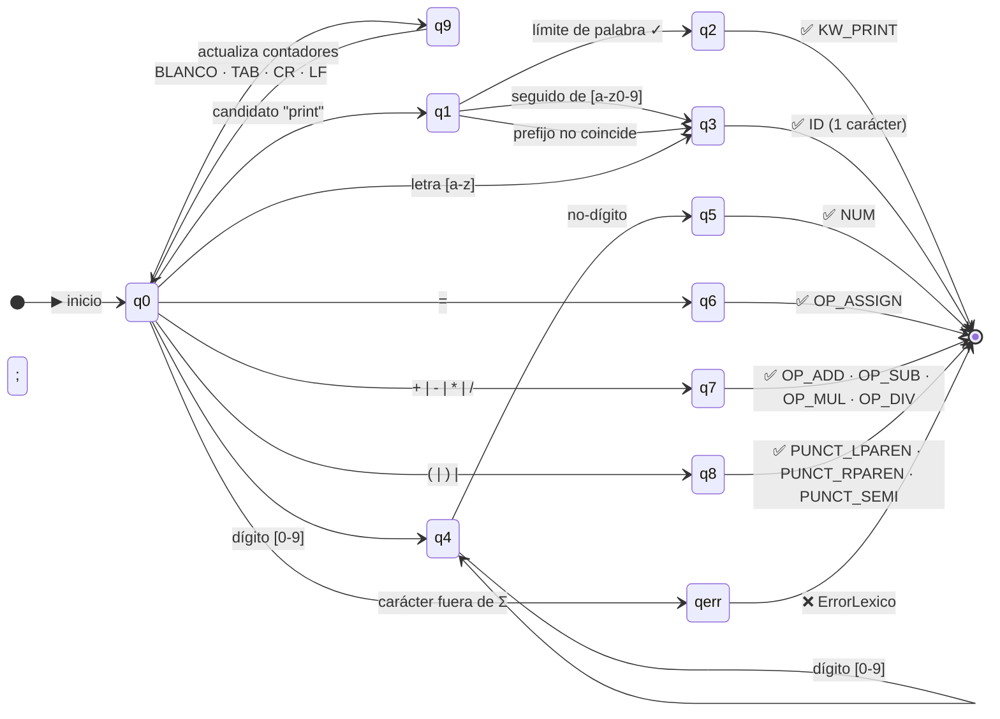

<div align="center">

# 🧮 Mini-calc — AFD y Tokens

### Documentación técnica del analizador léxico y sintáctico


-orange?style=for-the-badge)

> **Trabajo Práctico Final — Teoría de Autómatas**  
> Ingeniería en Informática · UNIDA · 2026

</div>

---

## 📋 Tabla de contenidos

| # | Sección |
|:-:|---------|
| 1 | [🔭 Visión general del proyecto](#1--visión-general-del-proyecto) |
| 2 | [🔤 Alfabeto y tokens del lenguaje](#2--alfabeto-y-tokens-del-lenguaje) |
| 3 | [📐 Definición formal del AFD](#3--definición-formal-del-afd) |
| 4 | [📊 Tabla de transiciones δ](#4--tabla-de-transiciones-δ) |
| 5 | [🗺️ Diagrama de estados](#5--diagrama-de-estados) |
| 6 | [🔍 Descripción de cada estado](#6--descripción-de-cada-estado) |
| 7 | [⚙️ Explicación de cada transición](#7--explicación-de-cada-transición) |
| 8 | [🔗 Integración con el parser](#8--integración-con-el-parser) |
| 9 | [📜 Gramática libre de contexto](#9--gramática-libre-de-contexto) |
| 10 | [▶️ Ejemplos de ejecución](#10--ejemplos-de-ejecución) |

---

## 1 · 🔭 Visión general del proyecto

**Mini-calc** es un intérprete mínimo que procesa un lenguaje de calculadora con dos tipos de sentencias:

| Sentencia | Sintaxis | Efecto |
|:---------:|----------|--------|
| **Asignación** | `ID = expresion ;` | Asigna el valor de la expresión a una variable |
| **Impresión** | `print expresion ;` | Evalúa e imprime la expresión |

### Pipeline de procesamiento

```
 ╔══════════════════╗
 ║  Código fuente   ║   ejemplo.calc / prueba2.calc
 ║    (.calc)       ║
 ╚════════╤═════════╝
          │
          ▼
 ╔══════════════════╗   tokens[]    ╔══════════════════╗
 ║     Lexer        ║ ────────────► ║     Parser       ║ ──► Árbol de derivación
 ║   (lexer.py)     ║               ║   (parser.py)    ║
 ╚══════════════════╝               ╚══════════════════╝
          │                                  │
          │ ErrorLexico                       │ ErrorSintactico
          ▼                                  ▼
 ╔══════════════════════════════════════════════════════╗
 ║               errores.py                            ║
 ║   ErrorLexico · ErrorSintactico (línea, columna)    ║
 ╚══════════════════════════════════════════════════════╝
```

### Archivos del proyecto

| Archivo | Responsabilidad |
|---------|----------------|
| `lexer.py` | Análisis léxico: convierte texto en tokens |
| `parser.py` | Análisis sintáctico: valida la gramática y construye el árbol |
| `errores.py` | Define `ErrorLexico` y `ErrorSintactico` |
| `arbol.py` | Nodo de árbol de derivación con visualización en consola |
| `main.py` | Punto de entrada: orquesta léxico + sintáctico |
| `pruebas.py` | Suite de 11 pruebas funcionales |
| `ejemplo.calc` | Programa de demostración con asignaciones y `print` |
| `prueba2.calc` | Segundo programa de demostración |

---

## 2 · 🔤 Alfabeto y tokens del lenguaje

### 2.1 — Alfabeto de entrada Σ

El lexer acepta únicamente los siguientes caracteres. Cualquier otro provoca un **error léxico**.

```
Σ = { a–z,  0–9,  =  +  -  *  /  (  )  ;  ' '  \t  \r  \n }
     ─────  ─────  ──────────────────  ─────────────────────
     letras dígitos    operadores /         blancos
                        puntuación
```

### 2.2 — Tokens producidos

| Token | Lexema | Categoría | Descripción |
|-------|:------:|:---------:|-------------|
| `KW_PRINT` | `print` | 🔑 Reservada | Solo si el carácter siguiente **no** es `[a-z0-9]` |
| `ID` | `x` `a` `z` | 🏷️ Identificador | Exactamente **una** letra minúscula |
| `NUM` | `0` `42` `100` | 🔢 Número | Uno o más dígitos consecutivos |
| `OP_ASSIGN` | `=` | ➡️ Operador | Asignación |
| `OP_ADD` | `+` | ➕ Operador | Suma |
| `OP_SUB` | `-` | ➖ Operador | Resta |
| `OP_MUL` | `*` | ✖️ Operador | Multiplicación |
| `OP_DIV` | `/` | ➗ Operador | División |
| `PUNCT_LPAREN` | `(` | 🔣 Puntuación | Paréntesis izquierdo |
| `PUNCT_RPAREN` | `)` | 🔣 Puntuación | Paréntesis derecho |
| `PUNCT_SEMI` | `;` | 🔣 Puntuación | Terminador de sentencia |
| `EOF` | _(vacío)_ | 🏁 Control | Fin de archivo; cierra `programa` en el parser |

### 2.3 — Caracteres ignorados

> Estos caracteres no producen ningún token; solo actualizan los contadores de posición.

| Carácter | Acción |
|:--------:|--------|
| `' '` espacio | `posicion += 1` · `columna += 1` |
| `\t` tabulación | `posicion += 1` · `columna += 1` |
| `\r` retorno de carro | `posicion += 1` · `columna += 1` |
| `\n` salto de línea | `posicion += 1` · `linea += 1` · `columna = 1` |

> 💡 **Nota:** cada token se almacena como la tupla `(tipo, valor, linea, columna)`.  
> Para `NUM`, la columna registrada es la del **primer dígito** de la secuencia.

---

## 3 · 📐 Definición formal del AFD

### 3.1 — La 5-tupla

$$M = (Q,\; \Sigma,\; \delta,\; q_0,\; F)$$

### 3.2 — Conjunto de estados Q

$$Q = \{\, q_0,\; q_1,\; q_2,\; q_3,\; q_4,\; q_5,\; q_6,\; q_7,\; q_8,\; q_9,\; q_{err} \,\}$$

| Estado | Nombre | Tipo | Descripción resumida |
|:------:|--------|:----:|----------------------|
| $q_0$ | Inicio / Despacho | 🟢 Inicial | Lee el carácter y elige la transición |
| $q_1$ | Candidato `print` | ⬜ Intermedio | Verifica si `"print"` es reservada o solo letra |
| $q_2$ | KW_PRINT | 🔵 Aceptación | `"print"` confirmado como token reservado |
| $q_3$ | ID | 🔵 Aceptación | Una letra minúscula como identificador |
| $q_4$ | Acumulando NUM | ⬜ Intermedio | Bucle de dígitos (auto-bucle) |
| $q_5$ | NUM | 🔵 Aceptación | Número completo al salir del bucle |
| $q_6$ | OP_ASSIGN | 🔵 Aceptación | Se leyó `=` |
| $q_7$ | Operador aritmético | 🔵 Aceptación | Se leyó `+`, `-`, `*` o `/` |
| $q_8$ | Puntuación | 🔵 Aceptación | Se leyó `(`, `)` o `;` |
| $q_9$ | Blanco / Salto | 🟡 Transitorio | Actualiza contadores, regresa a $q_0$ |
| $q_{err}$ | Error | 🔴 Trampa | Lanza `ErrorLexico`, termina el análisis |

### 3.3 — Conjunto de estados de aceptación F

$$F = \{\, q_2,\; q_3,\; q_5,\; q_6,\; q_7,\; q_8 \,\}$$

> ⚠️ $q_9$ **no** pertenece a $F$: solo actualiza contadores y vuelve a $q_0$.  
> ⛔ $q_{err}$ es el único estado trampa; interrumpe el análisis con excepción.

### 3.4 — Clasificación del alfabeto Σ

| Grupo | Símbolos |
|-------|----------|
| Letras | `a` `b` `c` … `z` |
| Dígitos | `0` `1` `2` … `9` |
| Operadores | `=` `+` `-` `*` `/` |
| Puntuación | `(` `)` `;` |
| Blancos | `' '` `\t` `\r` `\n` |
| Otros ∉ Σ | Cualquier otro carácter Unicode |

---

## 4 · 📊 Tabla de transiciones δ

> La función $\delta : Q \times \Sigma \rightarrow Q$ completa.  
> **Convención:** al llegar a un estado de aceptación, el token se emite y el AFD regresa a $q_0$.  
> Para `NUM`, el carácter que rompió el bucle **no** se consume.

### Desde $q_0$ — estado inicial

| Entrada | Estado siguiente | Token emitido |
|---------|:----------------:|:-------------:|
| `"print"` + (EOF o no-alfanumérico posterior) | $q_2$ | `KW_PRINT` |
| `"print"` + letra o dígito posterior | $q_3$ | `ID` (solo `"p"`) |
| Letra `[a-z]` (sin ser `print` reservada) | $q_3$ | `ID` |
| Dígito `[0-9]` | $q_4$ | _(pendiente)_ |
| `=` | $q_6$ | `OP_ASSIGN` |
| `+` `-` `*` `/` | $q_7$ | `OP_ADD` / `OP_SUB` / `OP_MUL` / `OP_DIV` |
| `(` `)` `;` | $q_8$ | `PUNCT_LPAREN` / `PUNCT_RPAREN` / `PUNCT_SEMI` |
| `' '` `\t` `\r` `\n` | $q_9$ | _(ninguno)_ |
| Cualquier otro (∉ Σ) | $q_{err}$ | _(excepción)_ |

### Desde $q_4$ — acumulando NUM

| Entrada | Estado siguiente | Acción |
|---------|:----------------:|--------|
| Dígito `[0-9]` | $q_4$ | Acumula en `numero`, avanza |
| No-dígito | $q_5$ | Sale del bucle **sin** consumir el carácter |
| Fin de archivo | $q_5$ | Sale del bucle |

### Estados de aceptación — $q_2$, $q_3$, $q_5$, $q_6$, $q_7$, $q_8$

Todos emiten su token correspondiente y regresan automáticamente a $q_0$.

### Estado $q_9$ — blanco

Actualiza contadores de línea/columna y regresa a $q_0$ sin emitir token.

### Estado $q_{err}$ — trampa

Lanza `ErrorLexico(mensaje, linea, columna)` y detiene la ejecución.

---

## 5 · 🗺️ Diagrama de estados



> 💡 **Renderizado automático** en GitHub, GitLab y VS Code (extensión *Markdown Preview Mermaid Support*).

---

## 6 · 🔍 Descripción de cada estado

| Estado | Tipo | Token emitido | Descripción funcional |
|:------:|:----:|:-------------:|----------------------|
| $q_0$ | 🟢 Inicial | — | **Despacho central.** Lee `self.codigo[self.posicion]` y elige la transición. No emite token. |
| $q_1$ | ⬜ Intermedio | — | **Verificación de `print`.** Detectada la `p`, comprueba que los 4 caracteres siguientes formen `rint` y que el posterior no sea alfanumérico. |
| $q_2$ | 🔵 Aceptación | `KW_PRINT` | Cadena `"print"` confirmada como palabra reservada. Avanza 5 posiciones. Emite `("KW_PRINT", "print", linea, columna)`. |
| $q_3$ | 🔵 Aceptación | `ID` | Una letra minúscula. Emite `("ID", caracter, linea, columna)`. **Solo un carácter.** |
| $q_4$ | ⬜ Intermedio | — | **Bucle de dígitos.** Acumula cada dígito en `numero` y avanza. Se queda en $q_4$ mientras sigan llegando dígitos. |
| $q_5$ | 🔵 Aceptación | `NUM` | El primer no-dígito (o EOF) interrumpe el bucle. Emite `("NUM", numero, linea, columna_inicio)`. La columna es la del primer dígito. |
| $q_6$ | 🔵 Aceptación | `OP_ASSIGN` | Leído `=`. Emite `("OP_ASSIGN", "=", linea, columna)` y avanza una posición. |
| $q_7$ | 🔵 Aceptación | `OP_ADD/SUB/MUL/DIV` | Leído `+`, `-`, `*` o `/`. El tipo se obtiene del diccionario `simbolos`. |
| $q_8$ | 🔵 Aceptación | `PUNCT_L/RPAREN/SEMI` | Leído `(`, `)` o `;`. Mismo mecanismo que $q_7$. |
| $q_9$ | 🟡 Transitorio | _(ninguno)_ | **Gestión de blancos.** `' '` `\t` `\r` avanzan columna. `\n` incrementa línea y reinicia columna a 1. Regresa a $q_0$. |
| $q_{err}$ | 🔴 Trampa | _(excepción)_ | Carácter fuera de Σ. Lanza `ErrorLexico(mensaje, linea, columna)`. Detiene el análisis. |

---

## 7 · ⚙️ Explicación de cada transición

### 7.1 · Blancos — $q_0 \xrightarrow{\text{blanco}} q_9 \rightarrow q_0$

```python
# lexer.py → analizar()
if caracter in " \t\r":
    self.avanzar()       # posicion += 1  ·  columna += 1
    continue

if caracter == "\n":
    self.posicion += 1
    self.linea += 1
    self.columna = 1
    continue
```

Espacios, tabulaciones y `\r` solo mueven el cursor de columna. El `\n` reinicia la columna a 1 y suma 1 a la línea. El `continue` vuelve al `while` sin emitir token — equivalente a regresar a $q_0$.

> 💡 Esto permite que `ErrorLexico` y `ErrorSintactico` reporten posiciones exactas sin importar el estilo de indentación o si el archivo usa `\r\n` (Windows) o `\n` (Unix).

---

### 7.2 · Palabra reservada — $q_0 \xrightarrow{\texttt{"print"}} q_1 \xrightarrow{?} q_2$ o $q_3$

```python
if self.codigo.startswith("print", self.posicion):
    fin = self.posicion + 5
    if fin == len(self.codigo) or not (
        self.es_letra(self.codigo[fin])
        or self.es_digito(self.codigo[fin])
    ):
        self.agregar_token("KW_PRINT", "print")
        for _ in range(5):
            self.avanzar()     # consume 'p' 'r' 'i' 'n' 't'
        continue
# Si falla, el flujo continúa hacia el bloque de ID
```

La transición opera en **dos sub-pasos**:

1. **Coincidencia de prefijo.** `startswith("print", pos)` examina 5 caracteres en O(1). No consume nada todavía.

2. **Verificación de límite de palabra.** Si `fin` supera el tamaño del archivo (EOF) o el carácter en `fin` no es alfanumérico → `"print"` es palabra reservada → $q_2$.  
   Si `fin` apunta a una letra o dígito → falla, el `if` no se ejecuta → el flujo llega al bloque de `ID` y emite `ID("p")` → $q_3$.

| Entrada | Resultado |
|---------|-----------|
| `print x` | ✅ `KW_PRINT` — el espacio no es alfanumérico |
| `print;` | ✅ `KW_PRINT` — `;` no es alfanumérico |
| `print` al final del archivo | ✅ `KW_PRINT` — `fin == len(codigo)` |
| `printa` | ⚠️ `ID("p")` `ID("r")` `ID("i")` `ID("n")` `ID("t")` `ID("a")` |
| `print2` | ⚠️ `ID("p")` `ID("r")` `ID("i")` `ID("n")` `ID("t")` `NUM("2")` |

---

### 7.3 · Identificadores — $q_0 \xrightarrow{[a\text{-}z]} q_3$

```python
if self.es_letra(caracter):
    self.agregar_token("ID", caracter)
    self.avanzar()
    continue
```

Este bloque se alcanza solo **después** de que el bloque `"print"` no haya consumido nada. Se emite un `ID` de **exactamente un carácter** y se avanza una posición.

> ⚠️ La gramática de Mini-calc **no soporta** identificadores multi-carácter. La entrada `xy` produce `ID("x")` seguido de `ID("y")`. La sentencia `xy = 5;` sería un error sintáctico: tras `ID("x")` el parser espera `OP_ASSIGN` y encuentra `ID("y")`.

---

### 7.4 · Números enteros — $q_0 \xrightarrow{[0\text{-}9]} q_4 \xrightarrow{[0\text{-}9]^*} q_4 \xrightarrow{\overline{[0\text{-}9]}} q_5$

```python
if self.es_digito(caracter):
    inicio = self.columna          # ← columna del PRIMER dígito
    numero = ""

    while (
        self.posicion < len(self.codigo)
        and self.es_digito(self.codigo[self.posicion])
    ):
        numero += self.codigo[self.posicion]
        self.avanzar()

    self.tokens.append(("NUM", numero, self.linea, inicio))
    continue
```

$q_4$ es el **único estado con auto-bucle** del AFD. Mientras lleguen dígitos se acumula en `numero`. Al aparecer un carácter no-dígito, el `while` termina **sin consumirlo**.

**Traza para `123+` comenzando en columna 2:**

| Paso | Columna | Carácter | `numero` | Acción |
|:----:|:-------:|:--------:|:--------:|--------|
| 1 | 2 | `1` | `"1"` | entra al bucle |
| 2 | 3 | `2` | `"12"` | continúa |
| 3 | 4 | `3` | `"123"` | continúa |
| 4 | 5 | `+` | — | sale del bucle (no consume) |
| — | — | — | — | emite `("NUM", "123", linea, 2)` |

---

### 7.5 · Operadores y puntuación — $q_0 \xrightarrow{\text{símbolo}} q_6 / q_7 / q_8$

```python
simbolos = {
    "=": "OP_ASSIGN",
    "+": "OP_ADD",    "-": "OP_SUB",
    "*": "OP_MUL",    "/": "OP_DIV",
    "(": "PUNCT_LPAREN",
    ")": "PUNCT_RPAREN",
    ";": "PUNCT_SEMI"
}

if caracter in simbolos:
    self.agregar_token(simbolos[caracter], caracter)
    self.avanzar()
    continue
```

Tokens de **un solo carácter**. El diccionario `simbolos` actúa como la función de transición implícita: dado el carácter, devuelve directamente el tipo. Los estados $q_6$, $q_7$ y $q_8$ se distinguen solo por claridad académica; comparten exactamente el mismo mecanismo de código.

---

### 7.6 · Error léxico — $q_0 \xrightarrow{\overline{\Sigma}} q_{err}$

```python
raise ErrorLexico(
    f"carácter no válido '{caracter}'",
    self.linea,
    self.columna
)
```

Si ninguna condición anterior se cumple, el carácter no pertenece a Σ. Se lanza `ErrorLexico` con el carácter, la línea y la columna exactas. La excepción sube hasta `main.py` donde se captura e imprime.

> ⛔ El análisis **se detiene por completo**. No hay recuperación de errores ni producción de tokens parciales.

```
❌  Error léxico: carácter no válido '@'. Línea 1, columna 10
```

---

### 7.7 · Fin de archivo — token `EOF`

```python
# Al terminar el while principal de analizar():
self.tokens.append(
    ("EOF", "", self.linea, self.columna)
)
return self.tokens
```

Una vez que `self.posicion` alcanza `len(self.codigo)`, el `while` termina. El lexer agrega `EOF` con la posición actual (justo después del último carácter). No corresponde a ningún carácter real: su único propósito es dar al parser una **condición de terminación explícita**.

---

## 8 · 🔗 Integración con el parser

El parser recibe la lista completa de tokens y la recorre con un índice. La operación central es `consumir(tipo)`:

```python
def consumir(self, tipo):
    token = self.token_actual()
    if token[0] == tipo:
        self.posicion += 1
        return token
    raise ErrorSintactico(
        f"se esperaba {tipo}, pero se encontró {token[0]}",
        token[2], token[3]
    )
```

El token `EOF` cumple **dos roles distintos**:

#### Rol 1 — Cierre explícito de `programa`

```python
def programa(self):
    self.lista_sentencias()
    self.consumir("EOF")   # ← falla si quedan tokens sobrantes
```

La regla `programa → lista_sentencias EOF` exige consumir `EOF` al final. Un token sobrante (p. ej. un `)` extra) provoca `ErrorSintactico` antes de llegar a esta línea.

#### Rol 2 — Condición de parada de `lista_sentencias`

```python
def lista_sentencias(self):
    if self.token_actual()[0] == "EOF":
        return          # ← producción epsilon
    self.sentencia()
    self.lista_sentencias()
```

La producción `lista_sentencias → ε` se activa exactamente cuando el token actual es `EOF`. Sin él, el parser no podría distinguir entre "no hay más sentencias" y "se acabó el archivo".

---

## 9 · 📜 Gramática libre de contexto

La gramática de Mini-calc, implementada en `parser.py`, es **LL(1)**: analizable con un token de anticipación y sin ambigüedad ni recursión izquierda.

```
programa         →  lista_sentencias  EOF

lista_sentencias →  sentencia  lista_sentencias
                 |  ε

sentencia        →  ID  OP_ASSIGN  expresion  PUNCT_SEMI
                 |  KW_PRINT  expresion  PUNCT_SEMI

expresion        →  termino  expresion_prima

expresion_prima  →  OP_ADD  termino  expresion_prima
                 |  OP_SUB  termino  expresion_prima
                 |  ε

termino          →  factor  termino_prima

termino_prima    →  OP_MUL  factor  termino_prima
                 |  OP_DIV  factor  termino_prima
                 |  ε

factor           →  PUNCT_LPAREN  expresion  PUNCT_RPAREN
                 |  ID
                 |  NUM
```

> 💡 La recursión **por la derecha** en `expresion_prima` y `termino_prima` evita la recursión izquierda directa (que haría al parser LL(1) entrar en bucle infinito) y garantiza **asociatividad izquierda** de los operadores.

### Precedencia de operadores

| Nivel | Operadores | Producción | Prioridad |
|:-----:|:----------:|:----------:|:---------:|
| 1 | `+` `-` | `expresion_prima` | más baja |
| 2 | `*` `/` | `termino_prima` | media |
| 3 | `()` `ID` `NUM` | `factor` | más alta |

---

## 10 · ▶️ Ejemplos de ejecución

### 10.1 — `ejemplo.calc`

```text
x = 10 + 5 * 2;
y = (x - 4) / 2;
print y;
```

**Tokens producidos:**

```
<ID,           "x",     1,  1>
<OP_ASSIGN,    "=",     1,  3>
<NUM,          "10",    1,  5>
<OP_ADD,       "+",     1,  8>
<NUM,          "5",     1, 10>
<OP_MUL,       "*",     1, 12>
<NUM,          "2",     1, 14>
<PUNCT_SEMI,   ";",     1, 15>
<ID,           "y",     2,  1>
<OP_ASSIGN,    "=",     2,  3>
<PUNCT_LPAREN, "(",     2,  5>
<ID,           "x",     2,  6>
<OP_SUB,       "-",     2,  8>
<NUM,          "4",     2, 10>
<PUNCT_RPAREN, ")",     2, 11>
<OP_DIV,       "/",     2, 13>
<NUM,          "2",     2, 15>
<PUNCT_SEMI,   ";",     2, 16>
<KW_PRINT,     "print", 3,  1>
<ID,           "y",     3,  7>
<PUNCT_SEMI,   ";",     3,  8>
```

**Árbol de derivación para `x = 10 + 5 * 2;`:**

```
└── E
    ├── T
    │   ├── F
    │   │   └── 10
    │   └── T'
    │       └── ε
    └── E'
        ├── +
        ├── T
        │   ├── F
        │   │   └── 5
        │   └── T'
        │       ├── *
        │       ├── F
        │       │   └── 2
        │       └── T'
        │           └── ε
        └── E'
            └── ε
```

---

### 10.2 — Error léxico

```text
x = 10 + @;
```

```
❌  Error léxico: carácter no válido '@'. Línea 1, columna 10
```

El lexer llega a `@`, ninguna condición lo cubre, lanza `ErrorLexico`. El análisis se detiene antes de llegar al parser.

---

### 10.3 — Error sintáctico

```text
x = + 10;
```

```
❌  Error sintáctico: expresión no válida. Línea 1, columna 5
```

El lexer produce tokens sin errores. El parser llega a `factor()` esperando `PUNCT_LPAREN`, `ID` o `NUM`, pero encuentra `OP_ADD` en la columna 5.

---

### 10.4 — `print` como prefijo de identificador más largo

```text
printa = 5;
```

El carácter en la posición `fin` es `a` (alfanumérico), por lo que `KW_PRINT` **no** se activa.

```
<ID, "p", 1, 1>  <ID, "r", 1, 2>  <ID, "i", 1, 3>
<ID, "n", 1, 4>  <ID, "t", 1, 5>  <ID, "a", 1, 6>
<OP_ASSIGN, "=", 1, 8>
<NUM, "5", 1, 10>
<PUNCT_SEMI, ";", 1, 11>
```

El parser intentará `sentencia → ID OP_ASSIGN ...` con `ID("p")` y fallará al esperar `OP_ASSIGN` pero encontrar `ID("r")` en la columna 2.

---

### 10.5 — Resumen de las 11 pruebas de `pruebas.py`

| # | Caso de prueba | Entrada | Resultado |
|:-:|----------------|---------|:---------:|
| 1 | Programa correcto | `x = 10 + 5 * 2;` | ✅ CORRECTO |
| 2 | Carácter no permitido | `x = 10 + @;` | ❌ Error léxico |
| 3 | Expresión incorrecta | `x = + 10;` | ❌ Error sintáctico |
| 4 | Paréntesis sin cerrar | `x = (10 + 5;` | ❌ Error sintáctico |
| 5 | Instrucción print | `print x;` | ✅ CORRECTO |
| 6 | Falta punto y coma | `x = 10 + 5` | ❌ Error sintáctico |
| 7 | Paréntesis de más | `x = 10 + 5);` | ❌ Error sintáctico |
| 8 | Print sin expresión | `print ;` | ❌ Error sintáctico |
| 9 | Todas las operaciones | `x = 20 + 10 - 5 * 2 / 2;` | ✅ CORRECTO |
| 10 | Paréntesis anidados | `x = ((10 + 5) * (8 - 3));` | ✅ CORRECTO |
| 11 | Imprimir una expresión | `print (10 + 5) * 2;` | ✅ CORRECTO |

---

<div align="center">

**Mini-calc · Teoría de Autómatas · UNIDA 2026**

*Documentación generada a partir del análisis directo de*  
`lexer.py` · `parser.py` · `errores.py` · `arbol.py` · `main.py` · `pruebas.py` · `ejemplo.calc` · `prueba2.calc`

</div>
